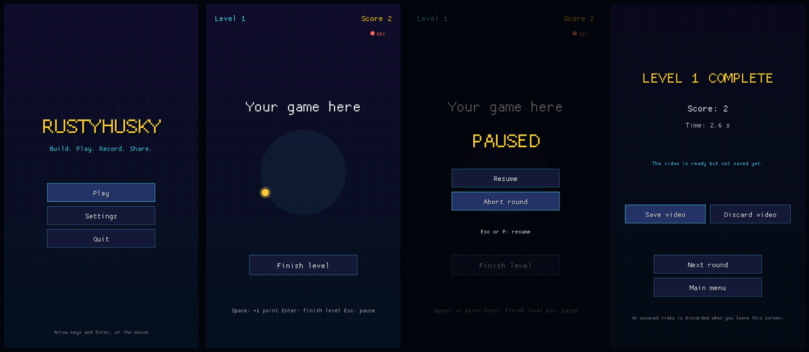

# RustyHusky

[](https://github.com/ricande/RustyHusky/actions/workflows/ci.yml)

**Build. Play. Record. Share.**

RustyHusky is a Rust starter framework for creating portrait games and
recording gameplay videos for social media platforms such as YouTube Shorts,
TikTok, and Instagram Reels. Build a game, play it, record it, and share it.

- **Portrait 9:16 gameplay** – a logical 540 × 960 view, scaled to any window
  without cropping or stretching, with correct mouse coordinates.
- **Automatic gameplay recording with audio** – every round is recorded
  while you play, including the game's sound effects.
- **1080 × 1920 MP4 video at 60 fps** – H.264 video with AAC stereo sound,
  independent of the window size.
- **Save or discard the recording after a level** – nothing is written to
  your video folder until you choose Save video.
- **A reusable foundation for quickly building new games** – menus,
  settings, pause, results, scaling and recording are done; you replace one
  game module.
- **English by default, with i18n support** – all texts go through one
  translation catalog; Swedish is included.



*Main menu, the placeholder game while recording, the pause menu (never part
of the video) and the results with Save video / Discard video.*

RustyHusky creates video files that you publish yourself. It does not upload
anything to social media platforms.

Built with [Macroquad](https://macroquad.rs). It also has a main menu (Play,
Settings, Quit), settings for language, volume and recording that are saved
between runs, a fixed simulation time step, and a placeholder game that shows
"Your game here", to be replaced by yours.

The framework grew out of [RustOut](https://github.com/ricande/RustOut), a
Breakout-style game; its general parts were kept and the Breakout parts
removed. All graphics are drawn in code and the sounds are synthesized at
startup, so there are no asset files.

## Requirements

- Rust (stable, 1.82 or later) via [rustup](https://rustup.rs)
- Linux: development packages for X11, ALSA and OpenGL, e.g. on Debian/Ubuntu:
  `sudo apt install libx11-dev libxi-dev libgl1-mesa-dev libasound2-dev`
- Windows and macOS need nothing extra to build.
- To record videos: [FFmpeg](https://ffmpeg.org) with the libx264 encoder, in
  `PATH` (Debian/Ubuntu: `sudo apt install ffmpeg`; macOS: `brew install
  ffmpeg`; Windows: an FFmpeg build such as the one from gyan.dev, with its
  `bin` folder in `PATH`). It is only needed at run time, not to build.
  Without it everything works except recording, and the settings and results
  screens say why.

## Running

```bash
cargo run --release
```

Tests (flow, settings, translations, scaling, recording pipeline) run without
a window; the video tests are skipped when FFmpeg is missing:

```bash
cargo test
```

## Playing

| Screen   | Keys / mouse |
| -------- | ------------ |
| Menus    | Mouse, or ↑/↓ and Enter (Space also chooses). Esc goes back. |
| Settings | ←/→ change the focused setting; click the left or right half of the volume button to lower or raise it. |
| Round    | Esc or P pauses. In the pause menu: Resume (also Esc/P) or Abort round. |
| Example  | Space: +1 point. Enter or the **Finish level** button: finish the level. |

Flow: **main menu → round → results → next round or main menu**. An aborted
round also ends on the results screen (without "Next round").

## Settings

Saved as `settings.json` in the data folder and loaded at the next start:

| Setting   | Values                    | Default |
| --------- | ------------------------- | ------- |
| Language  | English, Svenska          | English |
| Volume    | 0–100 % in steps of 10 %  | 80 %    |
| Recording | On / Off                  | On      |

Data folder: `$XDG_DATA_HOME/rustyhusky` (normally
`~/.local/share/rustyhusky`) on Linux, `~/Library/Application
Support/RustyHusky` on macOS, `%APPDATA%\RustyHusky` on Windows. A missing or
broken file gives the defaults.

## Video recording

When recording is on and FFmpeg is available, every round is recorded:

- **What:** only the game view, rendered separately at 1080 × 1920 (9:16),
  60 fps, H.264 – independent of the window size, without window borders,
  letterbox bars, the REC marker, the pause menu or the results screen.
- **When:** from the first frame of the round until the frame the level is
  finished (or the round is aborted). Paused time is left out of the video.
- **Afterwards:** the results screen shows "Finishing the video…" while the
  encoder finishes, then **Save video** and **Discard video**. Until you save,
  the video is only a temporary file in the system's temp folder. Leaving the
  results screen without saving discards it.
- **Where:** `~/Videos/RustyHusky/rustyhusky-<date>-<time>.mp4` (UTC; the
  Linux folder follows `XDG_VIDEOS_DIR`, macOS uses `~/Movies`, Windows
  `%USERPROFILE%\Videos`). Existing files are never overwritten; `-2`, `-3` …
  is added instead. The results screen shows the saved path.
- **Sound:** the video has a stereo AAC sound track with the game's sound
  effects, mixed from the recorded effect times so it stays in sync. It is
  always mixed at full effect volume, whatever the volume setting. Sounds
  from outside the game (other programs, the microphone) are not recorded,
  and menu sounds are never part of the video.
- **Errors:** a missing FFmpeg, an encoder that fails or a file that cannot
  be written is shown as a message; the game keeps working. A failed save
  can be retried. FFmpeg is stopped after 60 s if it ever hangs.
- **Clean-up:** temporary files are removed on Discard, on leaving the
  results, and when the program closes (also via the window's close button).
  Leftovers after a crash are removed at the next start once they are a day
  old.

## Building your own game

1. Name your project in `src/config.rs` (`APP_NAME`, `APP_ID`,
   `ENV_PREFIX`) and in `Cargo.toml`. The window title, menu title, data and
   video folders, file names and environment variables follow.
2. Create a module, e.g. `src/mygame.rs`, with a type that implements
   `game::Game` (see `src/game.rs` and the example in `src/example.rs`):
   - `TEXTS` – the game's own texts as (key, English, Swedish); must include
     `menu.subtitle`, the line under the title in the main menu
   - `new(level)` – start a round (level 1, 2, 3 … with "Next round")
   - `handle(&Input)` – once per frame: pressed and held keys, mouse position
     and clicks, all in logical coordinates (Esc/P are taken for pausing)
   - `update(dt)` – game logic with the fixed step `FIXED_DT` (1/120 s)
   - `draw(&View)` – draw in logical 540 × 960 coordinates through `View`
   - `take_sounds()` – sound effects started since the last call
   - `finished()` – `Some(RoundResult { score })` when the level is done
3. Add `mod mygame;` and set `type ActiveGame = mygame::MyGame;` in
   `src/main.rs`.
4. Show every text through `t!("key")` with the key in your `TEXTS`.
   `cargo test` fails if a key is missing or the languages' placeholders
   differ.
5. Need another key? Add a variant to `ui::Key` and one row to `ui::KEYS`.
   Another sound? Add it to `audio::Sfx`, `ALL` and `recipe`.
6. Delete `src/example.rs` and describe your rules in
   [docs/GAME_RULES.md](docs/GAME_RULES.md).

Menus, settings, pause, results, scaling, recording and translations of the
framework's texts need no changes.

## Environment variables

Handy for testing without touching your real settings and videos. The
prefix is `config::ENV_PREFIX` (`RUSTYHUSKY` here):

| Variable               | Effect                                            |
| ---------------------- | ------------------------------------------------- |
| `RUSTYHUSKY_DATA_DIR`  | folder for `settings.json`                        |
| `RUSTYHUSKY_VIDEO_DIR` | folder for saved videos                           |
| `RUSTYHUSKY_LANG`      | `en` or `sv`, overrides the saved language for this run |
| `RUSTYHUSKY_FFMPEG`    | path to the ffmpeg program (a wrong path simulates missing FFmpeg) |
| `RUSTYHUSKY_WINDOW`    | force a window size, e.g. `1000x640`              |
| `RUSTYHUSKY_SCRIPT`    | run a UI script instead of real input (see [AGENTS.md](AGENTS.md)) |
| `RUSTYHUSKY_SHOTS`     | folder for the script's screenshots (default `shots`) |

## Documentation

| Document | Contents |
| -------- | -------- |
| [docs/ARCHITECTURE.md](docs/ARCHITECTURE.md) | Modules, coordinates, time step, i18n, recording flow |
| [docs/GAME_RULES.md](docs/GAME_RULES.md) | The example game's behaviour; the place for your game's rules |
| [AGENTS.md](AGENTS.md) | Rules and checks for contributors and AI agents |
| [CHANGELOG.md](CHANGELOG.md) | Changes per version |
| [LICENSE](LICENSE) | GPL-3.0-or-later |
| [THIRD_PARTY_NOTICES.md](THIRD_PARTY_NOTICES.md) | RustOut (MIT), dependencies, FFmpeg, recorded videos |

## Known limitations

- Recording needs FFmpeg with libx264 at run time.
- Recording reads each frame back from the GPU (8 MB per frame); on slow
  machines this can lower the frame rate while recording. The video is still
  exactly 60 fps (pictures are repeated or skipped to match game time).
- The video sound contains only the game's synthesized effects.
- The start window size is fitted to the screen on X11/XWayland (via `xprop`
  and `xrandr`); elsewhere it starts at 360 × 640. It can always be resized.
- The built-in font covers Latin text (English and Swedish), not every script.

## License

RustyHusky is free software, licensed under the GNU General Public License,
version 3 or (at your option) any later version (GPL-3.0-or-later). The full
text is in [LICENSE](LICENSE).

- Code reused from [RustOut](https://github.com/ricande/RustOut) keeps its
  original MIT copyright and permission notice, in
  [LICENSES/MIT-RustOut.txt](LICENSES/MIT-RustOut.txt).
- The Rust dependencies and FFmpeg keep their own licenses. See
  [THIRD_PARTY_NOTICES.md](THIRD_PARTY_NOTICES.md).
- Gameplay videos you record are not automatically covered by the code
  license. Separate rights to any assets you use (graphics, music, sounds,
  fonts) still apply.
